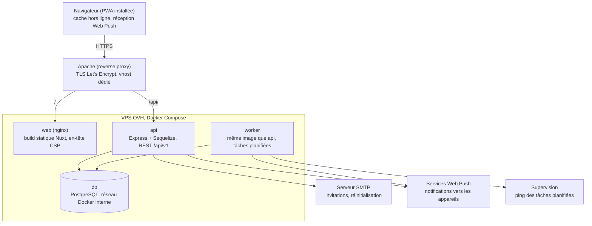

# Cahier des charges - Mint

Application web progressive de gestion de finances personnelles · Version 1.1 · 11 novembre 2026

## 1. Présentation du projet

Mint remplace les trois bases Notion utilisées aujourd'hui pour suivre l'argent. Il ajoute ce que Notion ne fait pas : le calcul automatique du solde prévisionnel de chaque compte, jour par jour.

L'identité visuelle et les règles d'interface sont fixées par la charte graphique (`docs/graphic-charter.md`), qui complète ce document sans le contredire.

### 1.1 Contexte

Le suivi actuel repose sur trois bases Notion :

- **Where money** : comptes et placements (compte courant, livrets, PEL, assurance-vie, PEA, plateformes crypto, titres-restaurant, portefeuille électronique), avec un usage et un solde saisi à la main.
- **Expenses tracker** : charges planifiées (abonnements, loyer, budgets variables, virements d'épargne) avec mode de déclenchement, moyen de paiement, montant mensualisé et récurrence.
- **Income Tracker** : revenus reçus, datés et catégorisés.

Ces bases ne relient pas une charge au compte débité, ne projettent aucun solde futur et ne rapprochent pas le prévu du réel.

### 1.2 Objectifs

1. Centraliser comptes, placements, revenus et dépenses de chaque utilisateur.
2. Planifier les échéances ponctuelles et récurrentes (dépenses, revenus, virements entre comptes) et les enveloppes budgétaires.
3. Calculer le solde prévisionnel de chaque compte et du total, jour par jour, sur un horizon configurable.
4. Rapprocher les opérations réelles, saisies ou importées, des échéances prévues.
5. Alerter avant un solde prévisionnel bas et rappeler les paiements à déclencher manuellement.

### 1.3 Périmètre

| Inclus                                                             | Exclu                                                                        |
| ------------------------------------------------------------------ | ---------------------------------------------------------------------------- |
| Application web progressive (PWA) responsive, installable          | Applications natives publiées sur les stores                                 |
| Instance privée, comptes créés sur invitation                      | Inscription publique, offre payante                                          |
| Saisie manuelle et import CSV                                      | Synchronisation bancaire (DSP2, agrégateurs), import OFX/QIF, OCR de tickets |
| Espaces de données strictement séparés par utilisateur             | Partage de comptes ou de budgets entre utilisateurs, dépenses partagées      |
| Valorisation manuelle des placements                               | Suivi de positions et de cours (titres, cryptos)                             |
| Interface en français et en anglais, montants en EUR               | Multi-devises                                                                |
| Protection standard des données (TLS, isolation, contrôle d'accès) | Chiffrement applicatif ou de bout en bout                                    |
| Reprise des données Notion par ressaisie manuelle                  | Import ou synchronisation depuis Notion                                      |

### 1.4 Glossaire

| Terme              | Définition                                                                                                                                                     |
| ------------------ | -------------------------------------------------------------------------------------------------------------------------------------------------------------- |
| Compte             | Emplacement où l'argent est détenu : compte courant, livret, PEL, assurance-vie, PEA, portefeuille crypto, carte titres-restaurant, portefeuille électronique. |
| Nature             | Type juridique ou technique d'un compte (liste fixe, cf. CPT-02). Détermine les comportements spécifiques : valorisation, plafond, intérêts.                   |
| Usage              | Rôle d'un compte dans la gestion (liste fixe) : Courant, Épargne de précaution, Épargne, Investissement.                                                       |
| Moyen de paiement  | Carte ou mode de virement rattaché à un compte. Détermine le compte débité ou crédité.                                                                         |
| Opération          | Mouvement réel (débit ou crédit) sur un compte : saisi, importé ou généré depuis une échéance.                                                                 |
| Échéance           | Mouvement planifié, ponctuel ou récurrent : dépense, revenu ou transfert interne.                                                                              |
| Occurrence         | Instance datée d'une échéance (ex. abonnement musical du 6 décembre 2026).                                                                                     |
| Transfert interne  | Mouvement entre deux comptes d'un même utilisateur. Débite la source, crédite la cible, neutre sur les totaux de revenus et de dépenses.                       |
| Groupe             | Classement fixe des dépenses : Needs (besoins), Wants (envies), Save (épargne).                                                                                |
| Enveloppe          | Budget mensuel plafonné sur une ou plusieurs catégories de dépenses variables (ex. courses 150 €/mois).                                                        |
| Rapprochement      | Association d'une opération réelle à une occurrence d'échéance.                                                                                                |
| Solde calculé      | Solde initial du compte + somme des opérations postérieures à sa date.                                                                                         |
| Solde relevé       | Solde constaté sur un relevé bancaire, saisi par l'utilisateur pour contrôle.                                                                                  |
| Valorisation       | Valeur de marché d'un placement à une date, saisie manuellement.                                                                                               |
| Solde prévisionnel | Solde projeté en fin de journée pour une date future, à partir des occurrences d'échéances et du reste des enveloppes.                                         |

## 2. Utilisateurs et rôles

L'instance est privée : trois profils, dont un seul administrateur, et aucune donnée financière visible par un autre que son propriétaire.

| Profil                    | Accès                                                                                                                              | Restrictions                                                           |
| ------------------------- | ---------------------------------------------------------------------------------------------------------------------------------- | ---------------------------------------------------------------------- |
| Visiteur non authentifié  | Page de connexion, acceptation d'invitation, réinitialisation du mot de passe                                                      | Aucune donnée, aucune inscription libre                                |
| Utilisateur               | Son propre espace : comptes, opérations, échéances, enveloppes, prévisions, notifications, préférences                             | Aucune visibilité sur les données des autres utilisateurs              |
| Administrateur d'instance | Tout ce que fait un utilisateur sur ses propres données + console d'administration (invitations, liste et statut des utilisateurs) | Aucun accès applicatif aux données financières des autres utilisateurs |

- Le porteur du projet est l'administrateur d'instance. Le premier compte administrateur est créé par une commande CLI au déploiement (ADM-07).
- Les utilisateurs sont des proches invités. Volumétrie cible : une dizaine de comptes utilisateurs (hypothèse, Annexe B).
- Chaque utilisateur dispose d'un espace totalement séparé. Aucun objet (compte, budget, échéance) ne peut être partagé entre utilisateurs.

## 3. Exigences fonctionnelles

Chaque exigence porte un identifiant `MODULE-NN` repris dans les user stories (section 4) et le découpage en lots (section 8). Toutes les données manipulées sont celles de l'utilisateur connecté.

### 3.1 Authentification et compte utilisateur (AUTH)

| ID      | Exigence                                                                                                                                                                                                                                   |
| ------- | ------------------------------------------------------------------------------------------------------------------------------------------------------------------------------------------------------------------------------------------ |
| AUTH-01 | Création de compte uniquement via un lien d'invitation nominatif (email), à usage unique, valable 7 jours. L'invité définit son mot de passe et sa langue.                                                                                 |
| AUTH-02 | Connexion par email + mot de passe. Mot de passe de 12 caractères minimum, haché en Argon2id.                                                                                                                                              |
| AUTH-03 | Passkeys (WebAuthn) : enregistrement d'une ou plusieurs passkeys nommées depuis le profil, connexion sans mot de passe, suppression. Le mot de passe reste défini comme recours.                                                           |
| AUTH-04 | Réinitialisation du mot de passe par lien email à usage unique, valable 1 heure. Réponse identique que l'adresse existe ou non.                                                                                                            |
| AUTH-05 | Sessions serveur : cookie HttpOnly, Secure, SameSite=Lax, expiration glissante de 30 jours. Liste des sessions actives et déconnexion globale depuis le profil. Toutes les sessions sont révoquées au changement de mot de passe.          |
| AUTH-06 | Limitation des tentatives : 5 échecs sur un compte en 15 minutes bloquent ce compte 15 minutes. Limitation complémentaire par adresse IP.                                                                                                  |
| AUTH-07 | Profil : email (changement confirmé sur la nouvelle adresse), langue FR/EN, horizon de prévision (1 à 12 mois, défaut 3), cibles de répartition (CAT-06), préférences de notification (NOTIF-06).                                          |
| AUTH-08 | Export complet à la demande : archive ZIP contenant un JSON intégral et un CSV par entité (comptes, opérations, échéances, enveloppes, catégories, tags, règles, relevés, valorisations).                                                  |
| AUTH-09 | Suppression de compte par l'utilisateur : confirmation par mot de passe ou passkey + ressaisie de l'email. Effacement définitif et immédiat de toutes ses données et sessions. Le dernier administrateur ne peut pas supprimer son compte. |

### 3.2 Administration (ADM)

| ID     | Exigence                                                                                                                                  |
| ------ | ----------------------------------------------------------------------------------------------------------------------------------------- |
| ADM-01 | Créer une invitation : saisie de l'email du destinataire, envoi d'un email contenant le lien (AUTH-01).                                   |
| ADM-02 | Lister les invitations (en attente, acceptée, expirée, révoquée), révoquer, renvoyer. Un renvoi invalide le lien précédent.               |
| ADM-03 | Lister les utilisateurs : email, rôle, langue, date de création, dernière connexion, statut.                                              |
| ADM-04 | Désactiver ou réactiver un utilisateur. La désactivation révoque ses sessions et suspend ses notifications ; ses données sont conservées. |
| ADM-05 | Déclencher l'envoi d'un lien de réinitialisation de mot de passe à un utilisateur.                                                        |
| ADM-06 | Ni la console ni aucune route d'administration n'exposent de donnée financière (comptes, montants, opérations, échéances, enveloppes).    |
| ADM-07 | Création du premier administrateur et promotion d'un utilisateur au rôle administrateur par commande CLI uniquement.                      |

### 3.3 Comptes (CPT)

| ID     | Exigence                                                                                                                                                                                                                                                                                                                                                                                         |
| ------ | ------------------------------------------------------------------------------------------------------------------------------------------------------------------------------------------------------------------------------------------------------------------------------------------------------------------------------------------------------------------------------------------------ |
| CPT-01 | Créer, modifier, archiver un compte : nom, nature, usage, établissement (optionnel), solde initial et date de ce solde, seuil d'alerte de solde bas (optionnel, NOTIF-01), ordre d'affichage.                                                                                                                                                                                                    |
| CPT-02 | Natures (liste fixe) : Compte courant ; Livret réglementé (Livret A, LDDS, LEP) ; Épargne logement (PEL, CEL) ; Assurance-vie ; PEA ou compte-titres ; Portefeuille crypto ; Titres-restaurant ; Portefeuille électronique ; Autre.                                                                                                                                                              |
| CPT-03 | Usages (liste fixe, non modifiable) : Courant, Épargne de précaution, Épargne, Investissement.                                                                                                                                                                                                                                                                                                   |
| CPT-04 | Solde calculé = solde initial (en début de journée de sa date) + somme des opérations datées de cette date ou après.                                                                                                                                                                                                                                                                             |
| CPT-05 | Rapprochement de solde : saisie d'un solde relevé à une date, affichage de l'écart avec le solde calculé en fin de cette date. Action « Corriger l'écart » : crée une opération d'ajustement (catégorie système Ajustement). Historique des relevés et des écarts consultable.                                                                                                                   |
| CPT-06 | Placements (natures Assurance-vie, PEA ou compte-titres, Portefeuille crypto) : saisie de valorisations datées. Affichage du total versé (solde initial + transferts entrants − sortants), de la dernière valorisation et de sa date, de la plus ou moins-value latente (en € et en %), de la courbe des valorisations. Solde de référence = dernière valorisation + flux postérieurs à sa date. |
| CPT-07 | Un compte archivé sort des vues courantes, de la prévision et des totaux ; son historique reste consultable. Un compte avec opérations ne peut qu'être archivé ; un compte sans opération peut être supprimé.                                                                                                                                                                                    |
| CPT-08 | Vue « Où est mon argent » (équivalent de la base Notion Where money) : comptes actifs groupés par usage, solde ou valorisation actuelle de chacun, sous-total par usage, total général, indicateur d'écart de rapprochement non résolu.                                                                                                                                                          |

### 3.4 Moyens de paiement (PAY)

| ID     | Exigence                                                                                                                                                            |
| ------ | ------------------------------------------------------------------------------------------------------------------------------------------------------------------- |
| PAY-01 | Créer, modifier, archiver un moyen de paiement : libellé, type, compte rattaché (obligatoire).                                                                      |
| PAY-02 | Types : Carte bancaire ; Virement émis (déclenché par l'utilisateur) ; Prélèvement ou virement déclenché par un tiers.                                              |
| PAY-03 | Toutes les cartes sont à débit immédiat : une dépense par carte affecte le compte rattaché à sa propre date. Le débit différé est hors périmètre.                   |
| PAY-04 | Une dépense ou un revenu (échéance ou opération) référence soit un moyen de paiement, soit directement un compte. Le compte impacté est celui du moyen de paiement. |
| PAY-05 | Un moyen de paiement archivé (carte expirée) reste affiché dans l'historique mais n'est plus proposé à la saisie.                                                   |

### 3.5 Catégories et tags (CAT)

| ID     | Exigence                                                                                                                                                                                                                                                                                     |
| ------ | -------------------------------------------------------------------------------------------------------------------------------------------------------------------------------------------------------------------------------------------------------------------------------------------- |
| CAT-01 | Trois groupes de dépenses fixes, non modifiables : Needs, Wants, Save (affichés Besoins, Envies, Épargne en français).                                                                                                                                                                       |
| CAT-02 | Catégories de dépenses libres sur deux niveaux (catégorie, sous-catégorie). Chaque catégorie de premier niveau appartient à Needs ou Wants ; la sous-catégorie hérite du groupe.                                                                                                             |
| CAT-03 | Le groupe Save ne contient aucune catégorie. Son montant sur une période = somme des transferts internes d'un compte d'usage Courant vers un compte d'usage Épargne de précaution, Épargne ou Investissement.                                                                                |
| CAT-04 | Catégories de revenus libres sur deux niveaux, sans groupe.                                                                                                                                                                                                                                  |
| CAT-05 | Jeu par défaut créé à l'inscription, modifiable. Needs : Logement, Courses, Alimentation, Transports, Santé, Énergie et télécoms, Assurances. Wants : Loisirs, Restaurants, Shopping, Sport, Services numériques, Voyages. Revenus : Salaire, Aides, Primes, Remboursements, Autres revenus. |
| CAT-06 | Cibles de répartition par utilisateur, en pourcentage, somme égale à 100, défaut 50 / 30 / 20 (Needs / Wants / Save).                                                                                                                                                                        |
| CAT-07 | Supprimer une catégorie utilisée impose de réaffecter ses opérations, échéances, enveloppes et règles à une autre catégorie du même type.                                                                                                                                                    |
| CAT-08 | Catégories système non supprimables : Ajustement (CPT-05), exclue de toutes les statistiques ; Intérêts (LIV-03), catégorie de revenus.                                                                                                                                                      |
| CAT-09 | Tags libres : plusieurs par opération ou échéance, transversaux aux catégories, utilisables en filtre (OPE-05).                                                                                                                                                                              |
| CAT-10 | Attribut booléen « abonnement » sur une échéance de dépense, indépendant du groupe et de la catégorie (ECH-09).                                                                                                                                                                              |

### 3.6 Opérations réelles (OPE)

| ID     | Exigence                                                                                                                                                                                                                                              |
| ------ | ----------------------------------------------------------------------------------------------------------------------------------------------------------------------------------------------------------------------------------------------------- |
| OPE-01 | Saisie manuelle d'une dépense ou d'un revenu : date, montant, sens (débit ou crédit), libellé, moyen de paiement ou compte, catégorie, tags, note.                                                                                                    |
| OPE-02 | Saisie d'un transfert interne : compte source, compte cible, montant, date, libellé, note. Crée deux mouvements liés (débit source, crédit cible), sans catégorie. Modifier ou supprimer l'un modifie ou supprime l'autre.                            |
| OPE-03 | Origine tracée et affichée : manuelle, import, générée depuis une échéance (EXE-01).                                                                                                                                                                  |
| OPE-04 | Statut : catégorisée ou à catégoriser. Une opération à catégoriser compte dans les soldes et reste signalée jusqu'à sa catégorisation.                                                                                                                |
| OPE-05 | Liste des opérations : pagination, tri par date ou montant, recherche plein texte (libellé, libellé bancaire, note), filtres combinables : période, comptes, groupes, catégories, tags, montant min et max, sens, origine, statut, rapprochée ou non. |
| OPE-06 | Modification et suppression d'une opération. Supprimer une opération rapprochée annule le rapprochement (RAP-05).                                                                                                                                     |
| OPE-07 | Conversion d'une opération en transfert interne : choix du compte de contrepartie. Si une opération de montant opposé existe sur ce compte à ±3 jours, les deux sont liées ; sinon la contrepartie est créée.                                         |
| OPE-08 | Montants en euros, stockés en centimes (entier signé), affichés selon la locale de l'utilisateur.                                                                                                                                                     |

### 3.7 Import CSV (IMP)

| ID     | Exigence                                                                                                                                                                                                                                                                                                                                      |
| ------ | --------------------------------------------------------------------------------------------------------------------------------------------------------------------------------------------------------------------------------------------------------------------------------------------------------------------------------------------- |
| IMP-01 | Import d'un fichier CSV (5 Mo maximum) dans un compte choisi.                                                                                                                                                                                                                                                                                 |
| IMP-02 | Assistant de configuration : séparateur (point-virgule, virgule, tabulation), encodage (UTF-8, Windows-1252), ligne d'en-tête, lignes ignorées en début et fin de fichier, format de date, séparateur décimal, colonnes date, libellé et montant. Le montant provient d'une colonne signée unique ou d'une paire de colonnes débit et crédit. |
| IMP-03 | Configuration mémorisée par compte, réappliquée automatiquement aux imports suivants, modifiable.                                                                                                                                                                                                                                             |
| IMP-04 | Aperçu avant validation : lignes interprétées et lignes en erreur avec leur motif.                                                                                                                                                                                                                                                            |
| IMP-05 | Doublons stricts : une ligne identique à une opération déjà importée sur le même compte (date, montant, libellé bancaire normalisé, rang parmi les lignes identiques du même jour) est exclue par défaut et signalée.                                                                                                                         |
| IMP-06 | Chaque ligne retenue passe par les règles de catégorisation (REG), puis par la recherche de rapprochement (RAP-01).                                                                                                                                                                                                                           |
| IMP-07 | Écran de validation : lignes à catégoriser et propositions de rapprochement à confirmer ou refuser, une par une ou en masse. Rien n'est enregistré avant la validation du lot.                                                                                                                                                                |
| IMP-08 | Historique des imports par compte : date, fichier, lignes lues, créées, exclues comme doublons, fusionnées. Annulation d'un import validé : suppression des opérations créées et restauration des opérations générées qu'il avait fusionnées (RAP-03).                                                                                        |

### 3.8 Règles de catégorisation (REG)

| ID     | Exigence                                                                                                                                                                                                                                                                             |
| ------ | ------------------------------------------------------------------------------------------------------------------------------------------------------------------------------------------------------------------------------------------------------------------------------------ |
| REG-01 | Règle : condition sur le libellé bancaire (contient, commence par, expression régulière ; insensible à la casse et aux accents), conditions optionnelles sur le compte, le sens et une plage de montant. Actions : catégorie, tags, ou conversion en transfert vers un compte donné. |
| REG-02 | Règles ordonnées par priorité ; seule la première règle satisfaite s'applique.                                                                                                                                                                                                       |
| REG-03 | Création rapide depuis une opération catégorisée à la main : règle pré-remplie avec le libellé bancaire normalisé (chiffres et dates retirés), à confirmer.                                                                                                                          |
| REG-04 | Une opération sans règle satisfaite prend le statut « à catégoriser ».                                                                                                                                                                                                               |
| REG-05 | Les règles s'appliquent à l'import. Action « Réappliquer les règles » sur une sélection d'opérations existantes, avec aperçu des changements avant confirmation.                                                                                                                     |

### 3.9 Échéances (ECH)

| ID     | Exigence                                                                                                                                                                                                                                                                                                                                                                                              |
| ------ | ----------------------------------------------------------------------------------------------------------------------------------------------------------------------------------------------------------------------------------------------------------------------------------------------------------------------------------------------------------------------------------------------------- |
| ECH-01 | Types d'échéance : dépense, revenu, transfert interne.                                                                                                                                                                                                                                                                                                                                                |
| ECH-02 | Champs communs : libellé, montant de référence (montant d'une occurrence, positif), date de début, fin optionnelle (date ou nombre d'occurrences), récurrence, règle de jours non ouvrés, mode de déclenchement (Automatique ou Manuel), délai de rappel (mode Manuel), tolérance de montant pour le rapprochement (défaut ±10 %), tags, note, motifs de libellé bancaire (RAP-06), actif ou inactif. |
| ECH-03 | Champs par type. Dépense : moyen de paiement ou compte, catégorie, attribut abonnement. Revenu : moyen de paiement ou compte, catégorie de revenus. Transfert : compte source et compte cible.                                                                                                                                                                                                        |
| ECH-04 | Récurrences : ponctuelle (date unique), toutes les N semaines, tous les N mois, tous les N ans (N ≥ 1). Ancrage sur la date de début : jour de semaine, jour du mois, ou jour et mois. Option « dernier jour du mois ». Un jour d'ancrage absent du mois (29, 30, 31) donne le dernier jour du mois.                                                                                                  |
| ECH-05 | Équivalent mensuel calculé, jamais saisi. N semaines : montant × 52 / (12 × N). N mois : montant / N. N ans : montant / (12 × N). Ponctuelle : non comptée. Exemples : 44,16 € par an donne 3,68 €/mois ; 120 € tous les 2 ans donne 5,00 €/mois.                                                                                                                                                     |
| ECH-06 | Jours non ouvrés, réglage par échéance : date exacte (défaut), jour ouvré précédent, jour ouvré suivant. Jours non ouvrés : samedi, dimanche, jours fériés légaux de France métropolitaine calculés par l'application (fêtes mobiles comprises).                                                                                                                                                      |
| ECH-07 | Exception d'occurrence : sur une occurrence future précise, surcharger le montant ou la date, ou la sauter, sans modifier l'échéance. C'est le mécanisme des montants variables : le montant de référence vaut estimation.                                                                                                                                                                            |
| ECH-08 | Modifier une échéance affecte les occurrences non exécutées uniquement. Les occurrences exécutées et leurs opérations restent inchangées. Une exception dont la date d'origine n'existe plus est supprimée et signalée.                                                                                                                                                                               |
| ECH-09 | Vue « Abonnements » : échéances actives marquées abonnement, avec montant de référence, périodicité, équivalent mensuel, prochaine occurrence, moyen de paiement, mode. Totaux mensuel et annuel.                                                                                                                                                                                                     |
| ECH-10 | Vue « Échéances » (équivalent de la base Notion Expenses tracker et des revenus attendus) : libellé, type, groupe et catégorie, mode, moyen de paiement ou comptes, montant de référence, récurrence, équivalent mensuel, prochaine occurrence. Filtres par type. Totaux mensuels des dépenses, des revenus et des transferts d'épargne.                                                              |
| ECH-11 | Échéance désactivée ou arrivée à sa fin : plus aucune occurrence générée ni projetée.                                                                                                                                                                                                                                                                                                                 |

### 3.10 Exécution des occurrences (EXE)

Une occurrence dont la date est passée est réputée exécutée : elle devient une opération définitive, corrigée plus tard par l'import si la banque diffère.

| ID     | Exigence                                                                                                                                                                                                                                                                                            |
| ------ | --------------------------------------------------------------------------------------------------------------------------------------------------------------------------------------------------------------------------------------------------------------------------------------------------- |
| EXE-01 | À la date effective d'une occurrence (après ECH-06 et ECH-07), si aucune opération ne lui est rapprochée, l'application crée une opération définitive d'origine « échéance » : montant de l'occurrence, compte du moyen de paiement, catégorie, tags. Pour un transfert : les deux mouvements liés. |
| EXE-02 | La règle vaut aussi pour le mode Manuel : l'occurrence est réputée exécutée à sa date. Le rappel (NOTIF-02) intervient avant.                                                                                                                                                                       |
| EXE-03 | Exécution par tâche planifiée quotidienne à 00:05 (Europe/Paris), idempotente : une occurrence ne produit jamais plus d'une opération. Rattrapage des jours manqués au démarrage du worker.                                                                                                         |
| EXE-04 | L'opération générée reste modifiable et supprimable. Sa suppression marque l'occurrence comme sautée : aucune régénération.                                                                                                                                                                         |
| EXE-05 | Sur un compte ayant déjà reçu au moins un import, une opération générée non rapprochée porte l'indicateur « non confirmée par la banque », visible et filtrable.                                                                                                                                    |

### 3.11 Rapprochement prévu / réel (RAP)

| ID     | Exigence                                                                                                                                                                                                                                                                                                                            |
| ------ | ----------------------------------------------------------------------------------------------------------------------------------------------------------------------------------------------------------------------------------------------------------------------------------------------------------------------------------- |
| RAP-01 | Pour chaque opération importée ou saisie, recherche des occurrences candidates : même compte, même sens, pas encore rapprochées d'une ligne bancaire, date effective à ±5 jours, montant dans la tolérance de l'échéance (ECH-02).                                                                                                  |
| RAP-02 | Score combinant écart de date, écart de montant et similarité du libellé bancaire avec le libellé et les motifs de l'échéance. La meilleure proposition est présélectionnée, les autres candidats restent consultables.                                                                                                             |
| RAP-03 | Validation sur une occurrence déjà exécutée (EXE-01) : la valeur importée fait foi. L'opération générée prend la date, le montant et le libellé bancaire de la ligne importée et passe en origine « import » ; aucune opération n'est créée en double. Les valeurs antérieures sont conservées pour l'annulation d'import (IMP-08). |
| RAP-04 | Validation sur une occurrence future (opération arrivée en avance) : l'occurrence est marquée exécutée, sort de la prévision et ne générera pas d'opération.                                                                                                                                                                        |
| RAP-05 | Rapprochement manuel depuis une opération : associer ou dissocier une occurrence. Dissocier une occurrence passée la marque comme sautée, sans régénération.                                                                                                                                                                        |
| RAP-06 | À chaque validation, le libellé bancaire normalisé s'ajoute aux motifs de l'échéance pour affiner les propositions suivantes.                                                                                                                                                                                                       |
| RAP-07 | Aucun rapprochement n'est enregistré sans validation explicite de l'utilisateur.                                                                                                                                                                                                                                                    |
| RAP-08 | Transfert : chaque mouvement (source, cible) se rapproche indépendamment sur son propre compte.                                                                                                                                                                                                                                     |

### 3.12 Enveloppes budgétaires (ENV)

| ID     | Exigence                                                                                                                                                                                                                                                |
| ------ | ------------------------------------------------------------------------------------------------------------------------------------------------------------------------------------------------------------------------------------------------------- |
| ENV-01 | Enveloppe : libellé, une ou plusieurs catégories de dépenses (sous-catégories incluses), montant mensuel, moyen de paiement ou compte par défaut (compte débité dans la prévision), mode de reliquat. Une catégorie appartient à une enveloppe au plus. |
| ENV-02 | Période : mois civil.                                                                                                                                                                                                                                   |
| ENV-03 | Consommé du mois = débits moins crédits (remboursements) des opérations du mois sur les catégories de l'enveloppe, toutes origines confondues.                                                                                                          |
| ENV-04 | Disponible du mois = montant mensuel + report du mois précédent (mode report) − consommé.                                                                                                                                                               |
| ENV-05 | Mode de reliquat, réglé par enveloppe : remise à zéro (chaque mois repart du montant mensuel) ou report (le disponible restant, positif ou négatif, s'ajoute au mois suivant).                                                                          |
| ENV-06 | Suivi : barre consommé / budget, disponible, disponible par jour restant. Mise en évidence au-delà de 80 % puis de 100 %.                                                                                                                               |
| ENV-07 | Montant spécifique pour un mois donné (exception mensuelle), sans changer le montant mensuel de référence.                                                                                                                                              |
| ENV-08 | Vue des enveloppes du mois : une ligne par enveloppe, totaux budget, consommé et disponible.                                                                                                                                                            |

### 3.13 Moteur de prévision (PRV)

Le solde prévisionnel d'un compte c en fin de journée J se calcule de proche en proche à partir du solde réel d'aujourd'hui :

```math
S_c(J) = S_c(J-1) + \sum_{f \in F_c(J)} m(f) - L_c(J) + I_c(J)
```

F\_c(J) regroupe les flux datés du jour J sur le compte c (occurrences non exécutées, opérations futures déjà saisies), m(f) leur montant signé, L\_c(J) la part d'enveloppes lissée ce jour-là, I\_c(J) les intérêts estimés crédités ce jour-là.

| ID     | Exigence                                                                                                                                                                                                                                                                                                                                                                                                                                                                                                                                                            |
| ------ | ------------------------------------------------------------------------------------------------------------------------------------------------------------------------------------------------------------------------------------------------------------------------------------------------------------------------------------------------------------------------------------------------------------------------------------------------------------------------------------------------------------------------------------------------------------------- |
| PRV-01 | Pour chaque compte actif et chaque jour J entre aujourd'hui et aujourd'hui + horizon : solde prévisionnel en fin de journée.                                                                                                                                                                                                                                                                                                                                                                                                                                        |
| PRV-02 | Point de départ (J = aujourd'hui) : solde calculé incluant toutes les opérations datées d'aujourd'hui ou avant (CPT-04), ou solde de référence pour un placement (CPT-06), moins la part d'enveloppes du jour. Les occurrences du jour sont déjà exécutées (EXE-03).                                                                                                                                                                                                                                                                                                |
| PRV-03 | Flux pris en compte : occurrences non exécutées à leur date effective (ECH-06, ECH-07) : dépenses en débit, revenus en crédit, transferts en débit de la source et crédit de la cible ; opérations datées après aujourd'hui déjà enregistrées ; parts d'enveloppes (PRV-04) ; intérêts estimés (LIV-03).                                                                                                                                                                                                                                                            |
| PRV-04 | Lissage des enveloppes. Mois en cours : reste = max(0, disponible − occurrences futures du mois sur les catégories de l'enveloppe), réparti également sur les jours restants du mois, aujourd'hui inclus. Mois futurs : reste = max(0, montant mensuel (ou exception ENV-07) − opérations déjà saisies datées du mois − occurrences du mois sur les catégories de l'enveloppe), réparti sur tous les jours du mois ; le report n'est pas projeté. Débit sur le compte par défaut de l'enveloppe. Répartition au centime, reste d'arrondi porté sur le dernier jour. |
| PRV-05 | Vue agrégée : somme des soldes prévisionnels des comptes actifs, avec sous-totaux par usage. Les transferts internes y sont neutres.                                                                                                                                                                                                                                                                                                                                                                                                                                |
| PRV-06 | Horizon : préférence utilisateur de 1 à 12 mois (défaut 3), modifiable ponctuellement depuis les vues.                                                                                                                                                                                                                                                                                                                                                                                                                                                              |
| PRV-07 | Indicateurs par compte : solde minimal sur l'horizon et sa date, premier jour sous le seuil d'alerte, premier jour négatif.                                                                                                                                                                                                                                                                                                                                                                                                                                         |
| PRV-08 | Calcul côté serveur à la demande, non persisté, toujours cohérent avec les données courantes (cible de performance en section 6).                                                                                                                                                                                                                                                                                                                                                                                                                                   |
| PRV-09 | Pour un jour passé, le solde affiché est le solde calculé réel de fin de journée.                                                                                                                                                                                                                                                                                                                                                                                                                                                                                   |

### 3.14 Calendrier (CAL)

| ID     | Exigence                                                                                                                                                                          |
| ------ | --------------------------------------------------------------------------------------------------------------------------------------------------------------------------------- |
| CAL-01 | Grille mensuelle (semaine commençant le lundi), navigation de mois en mois, du premier mois d'historique jusqu'à la fin de l'horizon.                                             |
| CAL-02 | Jour futur : occurrences (libellé, montant signé, marqueurs Manuel et abonnement) et solde prévisionnel de fin de journée. Mise en évidence sous le seuil d'alerte ou en négatif. |
| CAL-03 | Jour passé : opérations réelles (nombre et total) et solde calculé de fin de journée.                                                                                             |
| CAL-04 | Sélecteur : un compte ou la vue agrégée.                                                                                                                                          |
| CAL-05 | Clic sur un jour : détail du jour. Clic sur une occurrence : la modifier (montant, date, saut ; ECH-07) ou ouvrir son échéance.                                                   |
| CAL-06 | Écran de moins de 768 px : grille compacte à pastilles, détail du jour sélectionné sous la grille.                                                                                |

### 3.15 Livrets réglementés et épargne logement (LIV)

| ID     | Exigence                                                                                                                                                                                                                                                                                        |
| ------ | ----------------------------------------------------------------------------------------------------------------------------------------------------------------------------------------------------------------------------------------------------------------------------------------------- |
| LIV-01 | Plafond de versement par compte de nature Livret réglementé ou Épargne logement. Prérempli depuis une table de référence des plafonds réglementaires (gérée par l'administrateur, valeurs à vérifier au déploiement), modifiable par compte.                                                    |
| LIV-02 | Alerte non bloquante quand le solde hors intérêts capitalisés dépasse le plafond : à l'enregistrement d'une opération ou d'un transfert, et dès qu'une occurrence future dans l'horizon le ferait dépasser (signal sur l'échéance, dans le calendrier et dans le centre de notifications).      |
| LIV-03 | Intérêts estimés. Taux annuel par compte avec historique (date d'effet). Méthode par compte : quinzaines (versement productif à partir du 1er ou du 16 suivant, retrait improductif depuis le 1er ou le 16 précédent) ou journalière. Capitalisation au 31 décembre ou à une date anniversaire. |
| LIV-04 | Affichage : intérêts acquis estimés depuis la dernière capitalisation, montant projeté à la prochaine capitalisation.                                                                                                                                                                           |
| LIV-05 | À la date de capitalisation, une opération d'intérêts estimés (catégorie système Intérêts) est générée selon EXE-01 ; l'import du montant réel la corrige selon RAP-03.                                                                                                                         |

### 3.16 Tableau de bord (DSH)

| ID     | Exigence                                                                                                                                                                                                                                                                                                          |
| ------ | ----------------------------------------------------------------------------------------------------------------------------------------------------------------------------------------------------------------------------------------------------------------------------------------------------------------- |
| DSH-01 | Courbe du solde prévisionnel sur l'horizon : vue agrégée par défaut, sélecteur de compte, ligne du seuil d'alerte, point minimal annoté. Les 30 derniers jours affichent le solde réel.                                                                                                                           |
| DSH-02 | Répartition des dépenses sur une période (mois en cours par défaut) : par groupe Needs / Wants / Save comparé aux cibles (CAT-06), puis par catégorie au clic sur un groupe. Base : opérations réelles, catégorie Ajustement exclue. Remplace la vue Notion « Repartition ».                                      |
| DSH-03 | Revenus et dépenses par mois : 12 derniers mois en réel, mois de l'horizon en prévisionnel (occurrences + enveloppes), visuellement distingués ; solde mensuel revenus − dépenses ; transferts internes exclus.                                                                                                   |
| DSH-04 | Bandeau : patrimoine total actuel (somme des comptes actifs), alertes actives (lot 2 : comptes dont le solde prévisionnel passe sous le seuil dans les 7 prochains jours, PRV-07 ; lot 3 : s'y ajoutent les dépassements de plafond, LIV-02), opérations à catégoriser, propositions de rapprochement en attente. |

### 3.17 Notifications (NOTIF)

| ID       | Exigence                                                                                                                                                                                                                                                                                       |
| -------- | ---------------------------------------------------------------------------------------------------------------------------------------------------------------------------------------------------------------------------------------------------------------------------------------------- |
| NOTIF-01 | Alerte de solde prévisionnel bas : seuil optionnel par compte (CPT-01). Déclenchée quand le solde prévisionnel d'un des 7 prochains jours passe sous le seuil. Une alerte par compte et par épisode ; nouvelle alerte si le minimum baisse encore, ou si l'épisode se termine puis recommence. |
| NOTIF-02 | Rappel de paiement manuel : pour chaque occurrence d'une échéance en mode Manuel, rappel N jours avant (réglable par échéance, défaut 2) et le jour même.                                                                                                                                      |
| NOTIF-03 | Canaux : centre de notifications in-app (toujours actif) et Web Push (si autorisé sur l'appareil ; plusieurs appareils par utilisateur). Aucune notification par email. L'alerte de plafond (LIV-02) passe par le centre in-app uniquement.                                                    |
| NOTIF-04 | Centre in-app : liste chronologique, lu ou non lu, compteur dans l'en-tête, lien vers l'objet concerné, suppression.                                                                                                                                                                           |
| NOTIF-05 | Préférences : activation par type et par canal.                                                                                                                                                                                                                                                |
| NOTIF-06 | Évaluation par tâche planifiée quotidienne à 08:00 (Europe/Paris). L'alerte de solde bas est aussi réévaluée après chaque modification des données de l'utilisateur.                                                                                                                           |
| NOTIF-07 | Contenu push : compte ou échéance concerné, date, montant. Un clic ouvre l'objet dans l'application.                                                                                                                                                                                           |
| NOTIF-08 | Un abonnement push refusé par le service (HTTP 404 ou 410) est supprimé.                                                                                                                                                                                                                       |
| NOTIF-09 | iOS et iPadOS : le Web Push n'est disponible que pour la PWA installée sur l'écran d'accueil. L'application détecte ce cas et affiche la procédure d'installation.                                                                                                                             |

## 4. User stories et critères d'acceptation

Les critères sont chiffrés pour servir directement de cas de test. Date de référence : aujourd'hui = mercredi 11 novembre 2026, sauf mention contraire. Montants fictifs.

**US-01 - Inviter un proche** (ADM-01, AUTH-01)

En tant qu'administrateur, je veux inviter un proche par email afin qu'il crée son compte.

- Étant donné une invitation envoyée le 1er décembre 2026, quand l'invité ouvre le lien le 5 décembre, alors il définit mot de passe et langue et arrive sur un espace vide doté des catégories par défaut (CAT-05).
- Quand le même lien est ouvert le 9 décembre, alors la page indique l'expiration et aucun compte n'est créé.
- Quand un lien déjà accepté est rouvert, alors il est refusé.

**US-02 - Isolation des données** (section 2, ADM-06)

En tant qu'utilisateur, je veux que personne d'autre, administrateur compris, ne voie mes données dans l'application.

- Étant donné deux utilisateurs A et B, quand A appelle une route de l'API avec l'identifiant d'un compte de B, alors la réponse est 404 et aucune donnée n'est renvoyée.
- Quand l'administrateur ouvre la console, alors il ne voit que email, rôle, langue, dates et statut de chaque utilisateur.

**US-03 - Se connecter par passkey** (AUTH-03)

En tant qu'utilisateur, je veux me connecter sur mon téléphone sans saisir de mot de passe.

- Étant donné une passkey enregistrée sur le téléphone, quand je choisis « Se connecter avec une passkey », alors je suis connecté après la vérification biométrique.
- Quand cette passkey est supprimée du profil, alors toute tentative avec elle est refusée.

**US-04 - Savoir où est mon argent** (CPT-01, CPT-08)

En tant qu'utilisateur, je veux voir mes comptes regroupés par usage avec leurs totaux.

- Étant donné un compte courant (Courant) à 2 000 €, un LEP (Épargne de précaution) à 5 000 € et un Livret A (Épargne) à 12 000 €, quand j'ouvre la vue, alors je vois trois groupes aux sous-totaux de 2 000 €, 5 000 € et 12 000 € et un total de 19 000 €.

**US-05 - Corriger un écart avec la banque** (CPT-05)

En tant qu'utilisateur, je veux comparer le solde calculé à mon relevé et corriger l'écart.

- Étant donné un solde calculé de 1 250,00 € au 30 novembre, quand je saisis un solde relevé de 1 237,50 € à cette date, alors l'écart affiché est de −12,50 €.
- Quand je clique « Corriger l'écart », alors une opération Ajustement de −12,50 € datée du 30 novembre est créée, l'écart passe à 0 et l'ajustement n'apparaît dans aucune répartition.

**US-06 - Saisir un abonnement annuel** (ECH-04, ECH-05, ECH-09)

En tant qu'utilisateur, je veux saisir un abonnement annuel à son montant réel et voir son coût mensuel.

- Étant donné une dépense de 44,16 €, annuelle, ancrée au 25 janvier 2027, payée par la carte du compte courant, marquée abonnement, quand j'ouvre la vue Abonnements, alors elle affiche 3,68 €/mois et une prochaine occurrence au 25 janvier 2027.
- Dans le calendrier du compte courant, un débit de 44,16 € apparaît le lundi 25 janvier 2027 et aucun en décembre 2026.

**US-07 - Décaler une échéance au jour ouvré** (ECH-06)

En tant qu'utilisateur, je veux que mon loyer tombe sur le bon jour bancaire.

- Étant donné un loyer de 600 €, mensuel, le 1er, règle « jour ouvré suivant », alors l'occurrence de janvier 2027 est le lundi 4 janvier 2027 (1er férié, 2 et 3 en week-end) et celle de février le lundi 1er février 2027.

**US-08 - Ajuster une occurrence variable** (ECH-07)

En tant qu'utilisateur, je veux corriger le montant attendu d'un mois précis sans toucher à l'échéance.

- Étant donné un revenu mensuel estimé à 200 € le 5, quand je fixe l'occurrence du 5 janvier 2027 à 180 €, alors la prévision crédite 180 € le 5 janvier et 200 € le 5 février, et l'échéance garde 200 €.

**US-09 - Occurrence exécutée puis corrigée par l'import** (EXE-01, RAP-03, IMP-08)

En tant qu'utilisateur, je veux que mes soldes restent justes sans attendre l'import, puis que la banque fasse foi.

- Étant donné ce revenu de 200 € le 5 sur le compte courant (date exacte), quand la tâche de 00:05 s'exécute le 5 décembre 2026, alors une opération de +200 € d'origine « échéance » datée du 5 décembre existe.
- Quand j'importe le 8 décembre une ligne « 07/12/2026 VIR PRESTATION +187,00 », alors une proposition de rapprochement vers cette occurrence est affichée.
- Quand je la valide, alors l'opération vaut +187,00 € au 7 décembre, origine « import », et le compte n'a qu'une opération pour cette occurrence.
- Quand j'annule cet import, alors l'opération revient à +200 € au 5 décembre, origine « échéance ».

**US-10 - Planifier un virement d'épargne** (ECH-01, CAT-03, PRV-05)

En tant qu'utilisateur, je veux planifier un virement mensuel vers mon livret.

- Étant donné un transfert de 100 € le 6 de chaque mois du compte courant (Courant) vers le Livret A (Épargne), alors chaque 6 la prévision débite 100 € du compte courant, crédite 100 € le Livret A et laisse la vue agrégée inchangée.
- Pour le mois concerné, le groupe Save de la répartition augmente de 100 € et le total des dépenses du graphique revenus/dépenses n'augmente pas.

**US-11 - Lisser une enveloppe dans la prévision** (ENV-03 à ENV-05, PRV-04)

En tant qu'utilisateur, je veux que mon budget courses soit réparti sur les jours restants du mois.

- Étant donné une enveloppe Courses de 300 € sur le compte courant, en remise à zéro, 120 € déjà consommés en novembre et aucune occurrence future dans ses catégories, alors la prévision débite 9,00 € par jour du 11 au 30 novembre (180 € sur 20 jours).
- En décembre 2026, elle débite 9,67 € par jour du 1er au 30 et 9,90 € le 31.
- Le 15 novembre, après une dépense de 60 € et aucune autre depuis le 11, la prévision débite 7,50 € par jour du 15 au 30 (120 € sur 16 jours).

**US-12 - Lire le solde jour par jour** (CAL-02, PRV-01)

En tant qu'utilisateur, je veux voir dans le calendrier combien j'aurai chaque soir.

- Étant donné un compte sans enveloppe, solde calculé de 1 000 € le 11 novembre, une dépense prévue de 50 € le 20 et un revenu prévu de 1 500 € le 28, alors la case du 19 affiche 1 000 €, celle du 20 affiche −50 € et 950 €, celle du 28 affiche +1 500 € et 2 450 €.

**US-13 - Être prévenu d'un solde bas** (NOTIF-01, NOTIF-03)

En tant qu'utilisateur, je veux être averti avant que mon compte passe sous un seuil.

- Étant donné un seuil de 200 € sur le compte courant et un minimum prévu de 150 € dans 4 jours, quand la tâche de 08:00 s'exécute, alors je reçois une notification push et une notification in-app indiquant le compte, la date et 150 €.
- Le lendemain, situation inchangée : aucune nouvelle notification. Si le minimum descend à 100 € : nouvelle notification.

**US-14 - Ne pas oublier un paiement manuel** (NOTIF-02, EXE-02)

En tant qu'utilisateur, je veux un rappel avant chaque virement que je dois faire moi-même.

- Étant donné un transfert de 100 € en mode Manuel le 10 décembre avec rappel à 2 jours, alors je reçois un rappel le 8 décembre à 08:00 et un autre le 10 décembre à 08:00.

**US-15 - Respecter le plafond d'un livret** (LIV-01, LIV-02)

En tant qu'utilisateur, je veux savoir quand un versement prévu dépassera le plafond.

- Étant donné un LEP plafonné à 10 000 €, à 9 950 € hors intérêts, et un transfert prévu de 100 € le 6, alors la prochaine occurrence est marquée « dépasse le plafond de 50 € » dans l'échéance et le calendrier, une notification in-app est créée et l'enregistrement reste possible.

**US-16 - Suivre un placement** (CPT-06)

En tant qu'utilisateur, je veux connaître la plus-value latente de mon PEA.

- Étant donné un PEA avec 1 000 € de solde initial et 1 200 € de transferts entrants, quand je saisis une valorisation de 2 530 € au 30 novembre 2026, alors le total versé affiché est 2 200 € et la plus-value latente +330 € (+15,0 %).

**US-17 - Importer un relevé CSV** (IMP-02, IMP-03, IMP-05)

En tant qu'utilisateur, je veux importer le CSV de ma banque une seule fois configuré.

- Étant donné un premier fichier séparé par des points-virgules, encodé en Windows-1252, dates au format JJ/MM/AAAA et colonnes débit et crédit séparées, quand je configure l'assistant et valide, alors la configuration est enregistrée pour ce compte.
- Quand j'importe un second fichier au même format, alors il est interprété sans configuration.
- Quand je réimporte le premier fichier, alors toutes ses lignes sont signalées comme doublons et aucune opération n'est créée.

**US-18 - Catégoriser automatiquement** (REG-01, REG-04)

En tant qu'utilisateur, je veux que les libellés connus soient classés seuls.

- Étant donné une règle « libellé contient DEEZER » vers Services numériques, quand j'importe « PRLV SEPA DEEZER 06/12 », alors l'opération est catégorisée Services numériques.
- Quand j'importe « CB BOULANGERIE » sans règle correspondante, alors l'opération est « à catégoriser ».

**US-19 - Exporter puis supprimer mon compte** (AUTH-08, AUTH-09)

En tant qu'utilisateur, je veux récupérer mes données puis les effacer.

- Quand je lance l'export, alors je télécharge un ZIP contenant un JSON complet et un CSV par entité, dont les nombres de lignes correspondent aux données affichées.
- Quand je confirme la suppression, alors je suis déconnecté, plus aucune ligne liée à mon identifiant n'existe en base et mon adresse peut être réinvitée.

**US-20 - Consulter hors connexion** (NF-PWA-02)

En tant qu'utilisateur, je veux consulter mes dernières données sans réseau.

- Étant donné la PWA installée et le tableau de bord ouvert une fois en ligne, quand je l'ouvre hors connexion, alors le tableau de bord, les comptes et le calendrier s'affichent avec un bandeau « Hors ligne : données du … » et toutes les actions d'écriture sont désactivées.

## 5. Modèle de données

Le modèle compte 30 tables PostgreSQL réparties en six domaines ; les occurrences futures d'échéances ne sont pas stockées mais calculées à la volée.

Conventions :

- Clés primaires UUID, noms en snake\_case, `created_at` et `updated_at` en `timestamptz` sur toutes les tables.
- Dates financières en `date` (sans fuseau), interprétées en Europe/Paris. Montants en centimes, `bigint`.
- Toute table de données utilisateur porte `user_id` (directement ou via son parent), avec suppression en cascade depuis `users`. Chaque requête filtre sur l'utilisateur connecté ; toute référence croisée (compte, catégorie, moyen de paiement) est vérifiée comme appartenant au même utilisateur.
- Valeurs énumérées en contraintes `CHECK` ou types `ENUM`, listées entre parenthèses.

### 5.1 Identité et accès

| Table                   | Champs principaux                                                                                                                                                                                     | Contraintes                                                        |
| ----------------------- | ----------------------------------------------------------------------------------------------------------------------------------------------------------------------------------------------------- | ------------------------------------------------------------------ |
| users                   | email (citext), password\_hash, role (admin, user), locale (fr, en), status (active, disabled), forecast\_horizon\_months, target\_needs\_pct, target\_wants\_pct, target\_save\_pct, last\_login\_at | email unique ; horizon 1 à 12 ; somme des cibles = 100             |
| webauthn\_credentials   | user\_id, credential\_id, public\_key, sign\_count, transports, name, last\_used\_at                                                                                                                  | credential\_id unique                                              |
| sessions                | sid, user\_id, data, expires\_at, user\_agent, ip, last\_seen\_at                                                                                                                                     | store des sessions serveur                                         |
| invitations             | email, token\_hash, invited\_by, expires\_at, accepted\_at, revoked\_at                                                                                                                               | jeton stocké haché                                                 |
| password\_reset\_tokens | user\_id, token\_hash, expires\_at, used\_at                                                                                                                                                          | jeton stocké haché, usage unique                                   |
| email\_change\_tokens   | user\_id, new\_email (citext), token\_hash, expires\_at, used\_at                                                                                                                                     | jeton stocké haché, usage unique, validité 1 h (AUTH-07, ADR 0010) |
| regulated\_caps         | product (livret\_a, ldds, lep, pel, cel), cap\_cents, updated\_by                                                                                                                                     | référence globale (LIV-01), aucune donnée utilisateur              |

### 5.2 Comptes

| Table               | Champs principaux                                                                                                                                                                                                                                                                                                             | Contraintes                                                                                                                                                                                                                       |
| ------------------- | ----------------------------------------------------------------------------------------------------------------------------------------------------------------------------------------------------------------------------------------------------------------------------------------------------------------------------- | --------------------------------------------------------------------------------------------------------------------------------------------------------------------------------------------------------------------------------- |
| accounts            | user\_id, name, nature, regulated\_product (livret\_a, ldds, lep, pel, cel), usage, institution, initial\_balance\_cents, initial\_balance\_date, low\_balance\_threshold\_cents, deposit\_cap\_cents, interest\_method (fortnight, daily), capitalization (dec31, anniversary), anniversary\_date, sort\_order, archived\_at | regulated\_product obligatoire pour les natures Livret réglementé (livret\_a, ldds, lep) et Épargne logement (pel, cel), absent pour les autres ; champs d'intérêt et de plafond renseignés seulement pour les natures concernées |
| account\_statements | account\_id, date, balance\_cents, adjustment\_transaction\_id                                                                                                                                                                                                                                                                | relevés saisis (CPT-05) ; unique (account\_id, date) (ADR 0017)                                                                                                                                                                   |
| valuations          | account\_id, date, value\_cents                                                                                                                                                                                                                                                                                               | unique (account\_id, date) ; natures placements uniquement                                                                                                                                                                        |
| interest\_rates     | account\_id, effective\_date, annual\_rate `numeric(6,4)`                                                                                                                                                                                                                                                                     | unique (account\_id, effective\_date)                                                                                                                                                                                             |
| payment\_methods    | user\_id, account\_id, label, kind (card, transfer\_out, third\_party), archived\_at                                                                                                                                                                                                                                          | account\_id obligatoire                                                                                                                                                                                                           |

### 5.3 Classement

| Table                 | Champs principaux                                                                                                                                                                                                                       | Contraintes                                                                                                                                                                                                                                                                                                                    |
| --------------------- | --------------------------------------------------------------------------------------------------------------------------------------------------------------------------------------------------------------------------------------- | ------------------------------------------------------------------------------------------------------------------------------------------------------------------------------------------------------------------------------------------------------------------------------------------------------------------------------ |
| categories            | user\_id, parent\_id, kind (expense, income, adjustment), expense\_group (needs, wants), name, is\_system, sort\_order, archived\_at                                                                                                    | profondeur 2 maximum ; expense\_group requis au premier niveau des dépenses, hérité au second ; unique (user\_id, parent\_id, name) ; kind adjustment réservé à la catégorie système Ajustement (CAT-08) ; une catégorie système par kind et par utilisateur, au premier niveau : Intérêts (income) et Ajustement (adjustment) |
| tags                  | user\_id, name (citext)                                                                                                                                                                                                                 | unique (user\_id, name), casse ignorée (ADR 0018)                                                                                                                                                                                                                                                                              |
| transaction\_tags     | user\_id, transaction\_id, tag\_id                                                                                                                                                                                                      | clé composée ; user\_id porte les références composées vers transactions et tags (ADR 0018)                                                                                                                                                                                                                                    |
| schedule\_tags        | user\_id, schedule\_id, tag\_id                                                                                                                                                                                                         | clé composée ; user\_id porte les références composées vers schedules et tags (ADR 0018)                                                                                                                                                                                                                                       |
| categorization\_rules | user\_id, priority, match\_type (contains, starts\_with, regex), pattern, account\_id, sign (debit, credit, any), amount\_min\_cents, amount\_max\_cents, action\_category\_id, action\_tag\_ids, action\_transfer\_account\_id, active | une seule action de classement : catégorie ou transfert ; action\_tag\_ids ajoutée au lot 3 (ADR 0017), en plus de l'action de classement (ADR 0018)                                                                                                                                                                           |

### 5.4 Opérations et import

| Table            | Champs principaux                                                                                                                                                                                                                                                                           | Contraintes                                                                                                                                                                                                                                                                                                                                                       |
| ---------------- | ------------------------------------------------------------------------------------------------------------------------------------------------------------------------------------------------------------------------------------------------------------------------------------------- | ----------------------------------------------------------------------------------------------------------------------------------------------------------------------------------------------------------------------------------------------------------------------------------------------------------------------------------------------------------------- |
| transactions     | user\_id, account\_id, payment\_method\_id, date, amount\_cents (signé), label, bank\_label, note, category\_id, status (categorized, to\_categorize), origin (manual, import, schedule), import\_batch\_id, dedup\_hash, transfer\_group\_id, occurrence\_id, pre\_merge\_snapshot (jsonb) | index (user\_id, account\_id, date) ; unique (occurrence\_id, account\_id) ; les deux mouvements d'un transfert partagent transfer\_group\_id et n'ont pas de catégorie ; account\_id figé à la création, le moyen de paiement appartient alors à ce compte (ADR 0013) ; « rapprochée » et « non confirmée par la banque » sont déduites, sans colonne (ADR 0017) |
| import\_mappings | account\_id, delimiter, encoding, has\_header, skip\_top, skip\_bottom, date\_format, decimal\_separator, col\_date, col\_label, col\_amount, col\_debit, col\_credit                                                                                                                       | account\_id unique                                                                                                                                                                                                                                                                                                                                                |
| import\_batches  | account\_id, filename, status (pending, validated, cancelled), raw\_file (bytea, effacé à la validation), rows\_read, rows\_created, rows\_duplicate, rows\_merged, validated\_at, cancelled\_at                                                                                            | historique IMP-08                                                                                                                                                                                                                                                                                                                                                 |
| import\_rows     | batch\_id, row\_index, raw (jsonb), date, amount\_cents, bank\_label, dedup\_hash, error, duplicate, proposed\_rule\_id, proposed\_category\_id, proposed\_transfer\_account\_id, proposed\_schedule\_id, proposed\_original\_date, proposed\_tag\_ids, candidates (jsonb)                  | zone de transit de l'aperçu (ADR 0017), purgée à la validation, à l'abandon ou après 24 h                                                                                                                                                                                                                                                                         |

### 5.5 Planification

| Table                      | Champs principaux                                                                                                                                                                                                                                                                                                                                                                                                                                                                     | Contraintes                                                                                                                                                                                                                     |
| -------------------------- | ------------------------------------------------------------------------------------------------------------------------------------------------------------------------------------------------------------------------------------------------------------------------------------------------------------------------------------------------------------------------------------------------------------------------------------------------------------------------------------- | ------------------------------------------------------------------------------------------------------------------------------------------------------------------------------------------------------------------------------- |
| schedules                  | user\_id, kind (expense, income, transfer), label, amount\_cents, payment\_method\_id, account\_id, source\_account\_id, target\_account\_id, category\_id, is\_subscription, trigger\_mode (auto, manual), reminder\_days\_before, frequency (once, weekly, monthly, yearly), interval, start\_date, anchor\_last\_day, end\_date, max\_occurrences, business\_day\_rule (exact, previous, next), amount\_tolerance\_pct, bank\_label\_patterns (text\[\]), note, is\_system, active | comptes renseignés selon kind : exactement un moyen de paiement ou un compte, et une catégorie, pour une dépense ou un revenu ; deux comptes distincts pour un transfert ; interval ≥ 1 ; is\_system pour les intérêts (LIV-05) |
| schedule\_occurrences      | schedule\_id, original\_date, effective\_date, amount\_cents, state (overridden, skipped, executed)                                                                                                                                                                                                                                                                                                                                                                                   | unique (schedule\_id, original\_date) ; ligne créée seulement à l'exception, au saut ou à l'exécution                                                                                                                           |
| envelopes                  | user\_id, label, monthly\_amount\_cents, payment\_method\_id, account\_id, carry\_over, active                                                                                                                                                                                                                                                                                                                                                                                        | exactement un compte ou un moyen de paiement par défaut                                                                                                                                                                         |
| envelope\_categories       | user\_id, envelope\_id, category\_id                                                                                                                                                                                                                                                                                                                                                                                                                                                  | category\_id unique (une catégorie n'appartient qu'à un utilisateur) ; user\_id porte les références composées vers envelopes et categories (ADR 0013)                                                                          |
| envelope\_month\_overrides | envelope\_id, month (1er du mois), amount\_cents                                                                                                                                                                                                                                                                                                                                                                                                                                      | unique (envelope\_id, month)                                                                                                                                                                                                    |

### 5.6 Notifications

| Table                     | Champs principaux                                                                                    | Contraintes                                     |
| ------------------------- | ---------------------------------------------------------------------------------------------------- | ----------------------------------------------- |
| notifications             | user\_id, type (low\_balance, manual\_reminder, deposit\_cap), payload (jsonb), dedup\_key, read\_at | unique (user\_id, dedup\_key)                   |
| alert\_episodes           | account\_id, opened\_at, closed\_at, min\_cents, min\_date, last\_notified\_min\_cents               | un épisode ouvert maximum par compte (NOTIF-01) |
| push\_subscriptions       | user\_id, endpoint, p256dh, auth, user\_agent, last\_success\_at                                     | endpoint unique                                 |
| notification\_preferences | user\_id, type, in\_app, push                                                                        | clé (user\_id, type)                            |

### 5.7 Relations principales

- `users` 1–N `accounts`, `payment_methods`, `categories`, `tags`, `schedules`, `envelopes`, `categorization_rules`, `notifications`, `push_subscriptions`, `webauthn_credentials`, `sessions`.
- `accounts` 1–N `transactions`, `payment_methods`, `account_statements`, `valuations`, `interest_rates`, `import_batches` ; 1–1 `import_mappings`.
- `schedules` 1–N `schedule_occurrences` ; une occurrence exécutée est liée à 1 opération (dépense, revenu) ou 2 (transfert) via `transactions.occurrence_id`.
- `categories` référence elle-même via `parent_id` ; `envelopes` N–N `categories` via `envelope_categories`.

## 6. Exigences non fonctionnelles

La sécurité repose sur une protection standard sans chiffrement applicatif, décision du porteur ; l'isolation stricte entre utilisateurs est l'exigence la plus critique.

| ID         | Domaine              | Exigence                                                                                                                                                                                                                                                                                                                |
| ---------- | -------------------- | ----------------------------------------------------------------------------------------------------------------------------------------------------------------------------------------------------------------------------------------------------------------------------------------------------------------------- |
| NF-SEC-01  | Sécurité             | HTTPS uniquement, certificats Let's Encrypt, en-tête HSTS.                                                                                                                                                                                                                                                              |
| NF-SEC-02  | Sécurité             | En-têtes de sécurité des pages, servis par nginx dans le conteneur web : CSP sans 'unsafe-inline' pour les scripts (seul le script inline de configuration Nuxt est autorisé, par son empreinte sha256 calculée au build ; charte graphique, CHG-103), X-Content-Type-Options, Referrer-Policy, frame-ancestors 'none'. |
| NF-SEC-03  | Sécurité             | Protection CSRF sur toutes les requêtes modifiantes, en plus du cookie SameSite=Lax.                                                                                                                                                                                                                                    |
| NF-SEC-04  | Sécurité             | Validation de toutes les entrées côté serveur par schéma. Les expressions régulières saisies par l'utilisateur (REG-01) sont exécutées avec un moteur sans retour arrière (RE2) ou une limite de longueur et de temps.                                                                                                  |
| NF-SEC-05  | Sécurité             | Isolation : chaque route de l'API dispose d'un test automatisé d'accès croisé entre deux utilisateurs (US-02).                                                                                                                                                                                                          |
| NF-SEC-06  | Sécurité             | Aucun montant, libellé ni solde dans les journaux applicatifs. Journal d'audit des connexions et des actions d'administration.                                                                                                                                                                                          |
| NF-SEC-07  | Sécurité             | PostgreSQL inaccessible hors du réseau Docker interne. Secrets (session, VAPID, SMTP, base) en variables d'environnement, jamais versionnés.                                                                                                                                                                            |
| NF-SEC-08  | Sécurité             | Audit des dépendances en CI ; une vulnérabilité de sévérité haute ou critique bloque le pipeline.                                                                                                                                                                                                                       |
| NF-RGPD-01 | Données personnelles | Données limitées à l'email, aux préférences et aux données financières saisies. Export (AUTH-08) et suppression (AUTH-09) en libre-service.                                                                                                                                                                             |
| NF-PERF-01 | Performance          | Temps de réponse de l'API au 95e centile inférieur à 300 ms hors import et export, pour 10 utilisateurs et 10 000 opérations par utilisateur.                                                                                                                                                                           |
| NF-PERF-02 | Performance          | Prévision sur 12 mois pour 20 comptes, 200 échéances et 10 enveloppes calculée en moins de 500 ms côté serveur.                                                                                                                                                                                                         |
| NF-PERF-03 | Performance          | Import de 2 000 lignes (lecture, règles, rapprochement) traité en moins de 5 s.                                                                                                                                                                                                                                         |
| NF-PERF-04 | Performance          | Score Lighthouse Performance mobile supérieur ou égal à 85 sur le tableau de bord.                                                                                                                                                                                                                                      |
| NF-PWA-01  | PWA                  | Manifest et service worker ; application installable sur Android, iOS et desktop.                                                                                                                                                                                                                                       |
| NF-PWA-02  | PWA                  | Consultation hors connexion : dernières réponses des vues tableau de bord, comptes, calendrier (mois en cours et suivant), échéances et 90 derniers jours d'opérations. Bandeau horodaté, actions d'écriture désactivées.                                                                                               |
| NF-PWA-03  | PWA                  | Cache vidé à la déconnexion et à la suppression du compte.                                                                                                                                                                                                                                                              |
| NF-PWA-04  | PWA                  | Nouvelle version du service worker signalée à l'utilisateur avec rechargement à sa demande.                                                                                                                                                                                                                             |
| NF-I18N-01 | Langues              | Interface en français et en anglais, aucune chaîne en dur. Langue réglée par profil.                                                                                                                                                                                                                                    |
| NF-I18N-02 | Langues              | Formats de date, de nombre et de montant selon la locale ; devise unique EUR.                                                                                                                                                                                                                                           |
| NF-UX-01   | Ergonomie            | Responsive dès 360 px de large : barre de navigation basse sur mobile, barre latérale sur desktop.                                                                                                                                                                                                                      |
| NF-UX-02   | Ergonomie            | Thèmes clair et sombre, suivant le réglage du système par défaut.                                                                                                                                                                                                                                                       |
| NF-ACC-01  | Accessibilité        | Niveau WCAG 2.1 AA visé : contrastes, navigation au clavier, libellés de formulaires, alternative textuelle aux graphiques.                                                                                                                                                                                             |
| NF-COMP-01 | Compatibilité        | Deux dernières versions de Chrome, Edge, Firefox et Safari (macOS, iOS).                                                                                                                                                                                                                                                |
| NF-QUA-01  | Qualité              | TypeScript strict et règles de code de la section 7.5, vérifiés en CI et par hooks Git locaux.                                                                                                                                                                                                                          |
| NF-QUA-02  | Qualité              | Tests unitaires des modules de calcul : récurrences et jours fériés, équivalent mensuel, exécution, rapprochement, enveloppes, prévision, intérêts, lecture CSV. Couverture d'au moins 90 % sur ces modules ; US-06 à US-16 transcrites en tests.                                                                       |
| NF-QUA-03  | Qualité              | Tests d'intégration de l'API, dont les tests d'isolation NF-SEC-05.                                                                                                                                                                                                                                                     |
| NF-QUA-04  | Qualité              | Tests de bout en bout (Playwright) : invitation, connexion, création de compte et d'échéance, import avec rapprochement, calendrier.                                                                                                                                                                                    |
| NF-QUA-05  | Qualité              | CI/CD GitHub Actions décrite en section 7.6 : contrôles et tests sur chaque pull request, déploiement automatique à chaque push sur main.                                                                                                                                                                               |
| NF-QUA-06  | Qualité              | Documentation de l'API au format OpenAPI 3, générée depuis les schémas zod et publiée dans docs/ ; README d'installation renvoyant à docs/ (CODE-10).                                                                                                                                                                   |
| NF-OPS-01  | Exploitation         | Endpoint de santé vérifiant l'API et la base.                                                                                                                                                                                                                                                                           |
| NF-OPS-02  | Exploitation         | Chaque tâche planifiée signale succès ou échec à un service de supervision externe (ping de type Healthchecks.io) ; un échec alerte l'administrateur.                                                                                                                                                                   |
| NF-OPS-03  | Exploitation         | Journaux structurés JSON sur la sortie standard, rotation gérée par Docker.                                                                                                                                                                                                                                             |

Les sauvegardes de la base ne sont pas spécifiées dans ce cahier des charges.

## 7. Architecture et contraintes techniques

Mint se compose d'un front Nuxt et d'une API Express, déployés en quatre conteneurs Docker sur le VPS OVH existant, derrière Apache.

### 7.1 Stack imposée

| Couche                 | Choix                                                                                                                             | Exigences couvertes      |
| ---------------------- | --------------------------------------------------------------------------------------------------------------------------------- | ------------------------ |
| Front                  | Nuxt 4, Vue 3, TypeScript, Pinia ; mode SPA (`ssr: false`), build statique ; `experimental.entryImportMap: false`                 | toutes les vues          |
| Serveur statique       | nginx:alpine dans le conteneur `web` : fichiers du build, repli SPA sur `200.html`, en-tête CSP généré au build                   | NF-SEC-02                |
| Composants d'interface | Nuxt UI (Tailwind CSS)                                                                                                            | toutes les vues          |
| Icônes                 | @nuxt/icon (collections Iconify)                                                                                                  | CODE-11                  |
| Graphiques             | ECharts via vue-echarts, import à la carte                                                                                        | DSH-01 à DSH-03, CODE-11 |
| PWA                    | @vite-pwa/nuxt (Workbox)                                                                                                          | NF-PWA-01 à NF-PWA-04    |
| Langues                | @nuxtjs/i18n                                                                                                                      | NF-I18N-01, NF-I18N-02   |
| Runtime                | Node.js 24 LTS dans les images ; `engines.node` `>=22` ; ESM uniquement                                                           | CODE-04                  |
| API                    | Express, TypeScript ; REST JSON préfixée `/api/v1` ; compilée par `tsc` vers `dist/` (`module: NodeNext`, imports suffixés `.js`) | toutes                   |
| ORM et migrations      | Sequelize, Umzug ; migrations versionnées, exécutées au déploiement                                                               | section 5, section 7.6   |
| Base de données        | PostgreSQL, dernière version majeure supportée                                                                                    | section 5                |
| Validation             | zod ; schémas dans `schemas/`, types dérivés dans `types/`                                                                        | NF-SEC-04, CODE-09       |
| Documentation d'API    | OpenAPI 3 générée depuis les schémas zod (zod-to-openapi), publiée dans `docs/`                                                   | NF-QUA-06                |
| Authentification       | express-session avec store PostgreSQL, argon2, @simplewebauthn/server                                                             | AUTH-02 à AUTH-06        |
| Tâches planifiées      | node-cron dans un processus worker dédié                                                                                          | EXE-03, NOTIF-06         |
| Web Push               | web-push, clés VAPID                                                                                                              | NOTIF-03, NOTIF-07       |
| Emails                 | nodemailer via SMTP                                                                                                               | AUTH-01, AUTH-04         |
| Lecture CSV            | csv-parse et iconv-lite                                                                                                           | IMP-02                   |
| Jours fériés           | calcul interne (date de Pâques par algorithme)                                                                                    | ECH-06                   |
| Dépôt                  | un seul dépôt, npm workspaces : `front/`, `api/`, `shared/`                                                                       | CODE-08                  |
| Lint et formatage      | ESLint (flat config, typescript-eslint, eslint-plugin-vue) et Prettier (`semi: false`, `singleQuote: true`, `printWidth: 80`)     | CODE-13, CODE-16         |
| Tests                  | Vitest (unitaires et intégration, couverture v8), supertest, Playwright                                                           | NF-QUA-02 à NF-QUA-04    |
| Hooks Git              | simple-git-hooks ; commitlint (Conventional Commits)                                                                              | CODE-12, CODE-14         |
| CI/CD                  | GitHub Actions ; images publiées sur Docker Hub                                                                                   | section 7.6              |

### 7.2 Déploiement

- VPS OVH existant, Docker Compose, Apache en reverse proxy (un vhost dédié sur le sous-domaine `mint.dev-it.app`), certificats Let's Encrypt en mode webroot.
- Conteneurs : `web` (nginx:alpine : fichiers statiques du build Nuxt et en-têtes de sécurité des pages), `api` (Express), `worker` (même image que `api`, commande de lancement des tâches planifiées), `db` (PostgreSQL, volume persistant, non exposé).
- Routage Apache : `/api/` vers `api`, le reste vers `web`. Apache ne pose pas d'en-tête CSP : celui des pages vient de `web`.
- Fuseau Europe/Paris fixé par variable d'environnement pour `api` et `worker`.
- Un seul `worker` exécute les tâches. Un verrou consultatif PostgreSQL empêche toute exécution concurrente, en plus de l'idempotence (EXE-03).
- Images `mint-web` et `mint-api` publiées sur Docker Hub en dépôts publics, taguées `latest` et SHA du commit. Aucun secret n'est embarqué dans une image (NF-SEC-07).
- Déploiement automatique à chaque push sur `main`, après contrôles et tests verts (section 7.6). GitHub Actions se connecte en SSH au VPS, tire les images du SHA, exécute les migrations Umzug dans un conteneur éphémère (`docker compose run --rm api`), redémarre les services (`docker compose up -d`) seulement si elles réussissent, puis vérifie l'endpoint de santé (NF-OPS-01).
- Retour arrière : workflow déclenché à la main qui redéploie un SHA donné. Les migrations déjà appliquées ne sont pas annulées.
- Environnements : développement local sous Docker Compose, production.

### 7.3 Tâches planifiées

| Tâche                     | Heure (Europe/Paris) | Rôle                                                                       |
| ------------------------- | -------------------- | -------------------------------------------------------------------------- |
| Exécution des occurrences | 00:05 chaque jour    | EXE-01 à EXE-03, LIV-05                                                    |
| Purge                     | 03:00 chaque jour    | jetons et sessions expirés, lignes d'import en transit depuis plus de 24 h |
| Notifications             | 08:00 chaque jour    | NOTIF-01, NOTIF-02, LIV-02                                                 |

### 7.4 Schéma d'architecture



Le navigateur ne communique qu'avec Apache ; PostgreSQL n'est joignable que depuis le réseau Docker interne, par api et worker.

### 7.5 Règles de code et de dépôt (CODE)

Ces règles s'appliquent à tout le dépôt et sont contrôlées automatiquement, en CI et en local (CODE-13, CODE-14).

| ID      | Règle                                                                                                                                                                                                                                                                                                                                                                                                                                                                                |
| ------- | ------------------------------------------------------------------------------------------------------------------------------------------------------------------------------------------------------------------------------------------------------------------------------------------------------------------------------------------------------------------------------------------------------------------------------------------------------------------------------------ |
| CODE-01 | TypeScript `strict` dans tous les paquets, complété par `noUncheckedIndexedAccess`, `noImplicitOverride` et `verbatimModuleSyntax`. Aucun `any`, aucun `@ts-expect-error`, aucun `@ts-ignore`.                                                                                                                                                                                                                                                                                       |
| CODE-02 | Aucune assertion `as`, sauf `as const` et, dans le seul module de validation, à la frontière du JSON brut. L'assertion de non-nullité `!` est interdite.                                                                                                                                                                                                                                                                                                                             |
| CODE-03 | Les directives `eslint-disable` sont autorisées.                                                                                                                                                                                                                                                                                                                                                                                                                                     |
| CODE-04 | ESM uniquement : `"type": "module"` dans chaque `package.json`, aucun `require`. `engines.node` fixé à `>=22`.                                                                                                                                                                                                                                                                                                                                                                       |
| CODE-05 | Le moins de commentaires possible dans le code source : le code se documente par le nommage. Toute explication vit dans `docs/` à la racine (CODE-10).                                                                                                                                                                                                                                                                                                                               |
| CODE-06 | Aucun emoji nulle part dans le dépôt : code source, sorties console et CLI, documentation, README, messages de commit.                                                                                                                                                                                                                                                                                                                                                               |
| CODE-07 | Aucun tiret cadratin (U+2014) nulle part dans le dépôt, messages de commit compris. Tiret simple ou virgule à la place.                                                                                                                                                                                                                                                                                                                                                              |
| CODE-08 | Tout type et toute interface sont déclarés dans le dossier `types/` de leur paquet (`front/types/`, `api/types/`, `shared/types/`), jamais là où ils sont utilisés, même sans franchir de frontière de module. Les types communs à plusieurs paquets vont dans `shared/types/`. Cela couvre les props et emits des composants Vue, l'état des stores Pinia et les augmentations de modules (fichiers `.d.ts`). Les modules de logique les importent exclusivement par `import type`. |
| CODE-09 | Schémas zod (valeurs) dans `schemas/` ; types dérivés par `z.infer` déclarés dans `types/`. Le schéma est la source unique de vérité du type.                                                                                                                                                                                                                                                                                                                                        |
| CODE-10 | `docs/` (Markdown) contient : architecture et modèle de données, avec les règles de calcul (prévision, rapprochement, intérêts) ; décisions d'architecture (un ADR par fichier) ; exploitation (installation, variables d'environnement, déploiement, tâches planifiées, retour arrière) ; conventions de code (ces règles détaillées) ; spécification OpenAPI générée ; cahier des charges (`specifications.md`) et charte graphique (`graphic-charter.md`).                        |
| CODE-11 | Front : aucun élément `<svg>` écrit dans le code source. Hors champ : les fichiers .svg statiques de front/public/ et les SVG générés à l'exécution par ECharts (charte graphique, CHG-01 et CHG-70). Icônes par @nuxt/icon, graphiques par ECharts, composants par Nuxt UI.                                                                                                                                                                                                         |
| CODE-12 | Messages de commit au format Conventional Commits, vérifiés par commitlint.                                                                                                                                                                                                                                                                                                                                                                                                          |
| CODE-13 | Contrôles automatiques bloquants : règles ESLint (`no-explicit-any`, `consistent-type-assertions` limité à `as const` hors module de validation, `ban-ts-comment`, `no-non-null-assertion`, interdiction des déclarations `type` et `interface` hors `types/`, `vue/no-restricted-html-elements` pour `svg`, `consistent-type-imports`) et script de scan des caractères interdits (emoji, U+2014) sur tous les fichiers suivis par Git.                                             |
| CODE-14 | Hooks simple-git-hooks. pre-commit : ESLint, Prettier `--check` et scan des caractères interdits sur les fichiers indexés. commit-msg : commitlint et scan du message. Le typecheck complet est laissé à la CI.                                                                                                                                                                                                                                                                      |
| CODE-15 | Fins de ligne LF imposées pour tout le dépôt par `.gitattributes` (`* text=auto eol=lf`).                                                                                                                                                                                                                                                                                                                                                                                            |
| CODE-16 | Prettier appliqué à tout le dépôt, documentation comprise : `semi: false`, `singleQuote: true`, `printWidth: 80`.                                                                                                                                                                                                                                                                                                                                                                    |

### 7.6 Intégration et déploiement continus

Quatre workflows réutilisables (`*.inc.yml`) sont assemblés par trois workflows de déclenchement (`*.flow.yml`), tous placés dans `.github/workflows/`.

| Workflow réutilisable | Rôle                                                                                                                                          |
| --------------------- | --------------------------------------------------------------------------------------------------------------------------------------------- |
| `checks.inc.yml`      | ESLint, Prettier `--check`, typecheck (`tsc --noEmit`, `vue-tsc --noEmit`), scan des caractères interdits, commitlint sur les commits poussés |
| `tests.inc.yml`       | Vitest unitaires et intégration avec un service PostgreSQL, rapport de couverture, Playwright                                                 |
| `build.inc.yml`       | Construction et publication sur Docker Hub de `mint-web` et `mint-api`, tags `latest` et SHA du commit                                        |
| `deploy.inc.yml`      | Entrée : un SHA. SSH vers le VPS, pull des images, migrations, `docker compose up -d`, vérification de l'endpoint de santé                    |

| Workflow de déclenchement | Déclencheur                         | Enchaînement                                                                                              |
| ------------------------- | ----------------------------------- | --------------------------------------------------------------------------------------------------------- |
| `ci.flow.yml`             | pull request                        | `checks.inc.yml` et `tests.inc.yml`                                                                       |
| `release.flow.yml`        | push sur `main`                     | `checks.inc.yml`, puis `tests.inc.yml`, puis `build.inc.yml`, puis `deploy.inc.yml` avec le SHA du commit |
| `rollback.flow.yml`       | déclenchement manuel, SHA en entrée | `deploy.inc.yml`                                                                                          |

Secrets GitHub requis : identifiant et jeton Docker Hub, hôte, utilisateur, clé privée et empreinte d'hôte SSH du VPS.

## 8. Lots et priorisation

Quatre lots livrables séparément : le lot 1 suffit à abandonner Notion, le lot 2 branche les données bancaires réelles.

| Lot                                 | Priorité (MoSCoW) | Contenu                                                                                                                                                                                                                                                                                                                                                                                           | Critère de sortie                                                                                                            |
| ----------------------------------- | ----------------- | ------------------------------------------------------------------------------------------------------------------------------------------------------------------------------------------------------------------------------------------------------------------------------------------------------------------------------------------------------------------------------------------------- | ---------------------------------------------------------------------------------------------------------------------------- |
| 1 - Socle et remplacement de Notion | Must              | AUTH-01, AUTH-02, AUTH-04 à AUTH-07 ; ADM-01 à ADM-07 ; CPT-01 à CPT-04, CPT-07, CPT-08 ; PAY-01 à PAY-05 ; CAT-01 à CAT-08, CAT-10 ; OPE-01 à OPE-06, OPE-08 ; ECH-01 à ECH-11 ; EXE-01 à EXE-04 ; ENV-01 à ENV-06 ; PRV-01 à PRV-09 ; CAL-01 à CAL-06 ; DSH-01 ; NF-SEC, NF-PERF-02, NF-PWA-01, NF-I18N (structure, français), NF-UX-01, NF-QUA, NF-OPS, CODE-01 à CODE-16, CI/CD (section 7.6) | US-01, US-02, US-04, US-06 à US-08, US-10 à US-12 validées ; toutes les données des trois bases Notion ressaisies (Annexe A) |
| 2 - Réel bancaire                   | Must              | IMP-01 à IMP-08 ; REG-01 à REG-04 ; RAP-01 à RAP-08 ; CPT-05 ; EXE-05 ; OPE-07 ; DSH-02 à DSH-04 ; NF-PERF-03                                                                                                                                                                                                                                                                                     | US-05, US-09, US-17, US-18 validées                                                                                          |
| 3 - Alertes, épargne, autonomie     | Should            | NOTIF-01 à NOTIF-09 ; LIV-01 à LIV-05 ; DSH-04 (alertes de plafond) ; CPT-06 ; AUTH-03, AUTH-08, AUTH-09 ; CAT-09 ; NF-PWA-02 à NF-PWA-04 ; traduction anglaise complète                                                                                                                                                                                                                          | US-03, US-13 à US-16, US-19, US-20 validées                                                                                  |
| 4 - Confort                         | Could             | ENV-07, ENV-08 ; REG-05 ; NF-UX-02 ; NF-ACC-01 au-delà des contrastes et du clavier                                                                                                                                                                                                                                                                                                               | revue d'accessibilité sans anomalie bloquante                                                                                |

Won't pour cette version : tous les éléments de la colonne « Exclu » du périmètre (section 1.3).

## Annexe A - Correspondance Notion vers Mint

Chaque champ des trois bases Notion a un équivalent dans Mint ; la reprise se fait par ressaisie manuelle, qui doit couvrir la totalité des lignes.

| Base Notion      | Champ ou vue         | Valeurs observées                                                 | Équivalent Mint                                                                                                                                                                                |
| ---------------- | -------------------- | ----------------------------------------------------------------- | ---------------------------------------------------------------------------------------------------------------------------------------------------------------------------------------------- |
| Where money      | Name                 | nom du compte                                                     | Compte : nom (CPT-01)                                                                                                                                                                          |
| Where money      | Usage                | Emergency, Courant, Save                                          | Compte : usage. Emergency donne Épargne de précaution ; Courant donne Courant ; Save donne Épargne (livrets, PEL, épargne bancaire) ou Investissement (PEA, assurance-vie, plateformes crypto) |
| Where money      | (absent)             | -                                                                 | Compte : nature, choisie à la ressaisie (CPT-02)                                                                                                                                               |
| Where money      | Amount               | montant en euros                                                  | Solde initial daté du jour de ressaisie ; première valorisation pour un placement (CPT-06)                                                                                                     |
| Where money      | Total (SUM)          | somme des montants                                                | Total de la vue « Où est mon argent » (CPT-08)                                                                                                                                                 |
| Expenses tracker | Name                 | libellé de la charge                                              | Échéance : libellé. Les budgets sans date (envies, courses, alimentation) deviennent des enveloppes (ENV-01)                                                                                   |
| Expenses tracker | Category             | Subscription                                                      | Attribut abonnement (CAT-10) + catégorie de dépenses rattachée à Needs ou Wants                                                                                                                |
| Expenses tracker | Category             | Needs, Wants                                                      | Groupe, porté par la catégorie choisie (CAT-02)                                                                                                                                                |
| Expenses tracker | Category             | Save                                                              | Échéance de type transfert interne vers le compte d'épargne (ECH-01) ; groupe Save calculé (CAT-03)                                                                                            |
| Expenses tracker | Type                 | Manual, Auto                                                      | Mode de déclenchement Manuel ou Automatique (ECH-02)                                                                                                                                           |
| Expenses tracker | How                  | Credit Card CA, Credit Card RVLT                                  | Moyens de paiement de type Carte, rattachés au compte courant Crédit Agricole et au compte Revolut (PAY-01)                                                                                    |
| Expenses tracker | How                  | Transfer (triggered by me)                                        | Moyen de paiement Virement émis, ou échéance de transfert interne entre comptes de l'utilisateur                                                                                               |
| Expenses tracker | How                  | Transfer (triggered by external)                                  | Moyen de paiement Prélèvement ou virement tiers, ou transfert interne si le compte cible appartient à l'utilisateur                                                                            |
| Expenses tracker | Amount per month     | montant mensualisé                                                | Équivalent mensuel calculé (ECH-05). Le montant saisi est celui d'une occurrence : montant mensualisé × 12 pour Yearly, × 24 pour Every 2 years                                                |
| Expenses tracker | Recurrence           | Monthly, Yearly, Every 2 years                                    | Tous les 1 mois, tous les 1 an, tous les 2 ans (ECH-04)                                                                                                                                        |
| Expenses tracker | Every                | « Every 6th », « September 12th », « Next on January 19th, 2027 » | Date de début servant d'ancrage (ECH-04). Ligne sans valeur : date à fixer à la ressaisie                                                                                                      |
| Expenses tracker | Total (SUM)          | total mensualisé                                                  | Totaux mensuels de la vue Échéances (ECH-10)                                                                                                                                                   |
| Expenses tracker | Vue Repartition      | répartition par catégorie                                         | Répartition du tableau de bord (DSH-02)                                                                                                                                                        |
| Income Tracker   | Income Source        | source du revenu                                                  | Revenu attendu : échéance de type revenu ; revenu reçu : opération de crédit                                                                                                                   |
| Income Tracker   | Amount               | montant                                                           | Montant de référence de l'échéance, ou montant de l'opération                                                                                                                                  |
| Income Tracker   | Date Received        | date de réception                                                 | Ancrage de l'échéance (jour du mois) ; date des opérations passées                                                                                                                             |
| Income Tracker   | Category             | Aid, Salary                                                       | Catégories de revenus Aides et Salaire (CAT-05)                                                                                                                                                |
| Income Tracker   | Vue Monthly Calendar | revenus par jour                                                  | Calendrier (CAL-01)                                                                                                                                                                            |

Volume à ressaisir : 13 comptes, au moins 16 charges planifiées et 3 sources de revenus. La capture d'écran de la base Expenses tracker ne montre pas toutes les lignes : la ressaisie s'appuie sur la base Notion complète.

## Annexe B - Hypothèses retenues par défaut

Les valeurs ci-dessous n'ont pas été arbitrées par le porteur du projet ; elles s'appliquent tant qu'elles ne sont pas modifiées.

| Sujet                                  | Valeur retenue                                                           | Référence             |
| -------------------------------------- | ------------------------------------------------------------------------ | --------------------- |
| Volumétrie                             | une dizaine d'utilisateurs, 10 000 opérations par utilisateur            | section 2, NF-PERF-01 |
| Validité d'une invitation              | 7 jours                                                                  | AUTH-01               |
| Longueur minimale du mot de passe      | 12 caractères                                                            | AUTH-02               |
| Validité du lien de réinitialisation   | 1 heure                                                                  | AUTH-04               |
| Durée de session                       | 30 jours glissants                                                       | AUTH-05               |
| Blocage après échecs                   | 5 échecs en 15 minutes, blocage 15 minutes                               | AUTH-06               |
| Catégories par défaut                  | liste de CAT-05                                                          | CAT-05                |
| Cibles de répartition                  | 50 / 30 / 20                                                             | CAT-06                |
| Fenêtre d'appariement d'un transfert   | ±3 jours                                                                 | OPE-07                |
| Taille maximale d'un CSV               | 5 Mo                                                                     | IMP-01                |
| Fenêtre et tolérance de rapprochement  | ±5 jours, ±10 % par défaut                                               | RAP-01, ECH-02        |
| Seuils de suivi des enveloppes         | 80 % et 100 %                                                            | ENV-06                |
| Report d'enveloppe sur les mois futurs | non projeté                                                              | PRV-04                |
| Jours non ouvrés                       | week-ends et jours fériés de France métropolitaine                       | ECH-06                |
| Fenêtre d'alerte de solde bas          | 7 jours                                                                  | NOTIF-01              |
| Délai de rappel des paiements manuels  | 2 jours avant et le jour même                                            | NOTIF-02              |
| Contenu des notifications push         | montants affichés                                                        | NOTIF-07              |
| Heures des tâches planifiées           | 00:05, 03:00, 08:00                                                      | section 7.3           |
| Plafonds réglementaires                | valeurs en vigueur à vérifier au déploiement                             | LIV-01                |
| Options TypeScript complémentaires     | `noUncheckedIndexedAccess`, `noImplicitOverride`, `verbatimModuleSyntax` | CODE-01               |
| Noms des images Docker                 | `mint-web`, `mint-api`                                                   | section 7.2           |
| Profondeur du cache hors ligne         | 90 jours d'opérations                                                    | NF-PWA-02             |
| Cibles de performance                  | valeurs de NF-PERF-01 à NF-PERF-04                                       | section 6             |
| Accessibilité                          | WCAG 2.1 AA                                                              | NF-ACC-01             |
| Thèmes                                 | clair et sombre                                                          | NF-UX-02              |
| Couverture de tests                    | 90 % sur les modules de calcul                                           | NF-QUA-02             |
